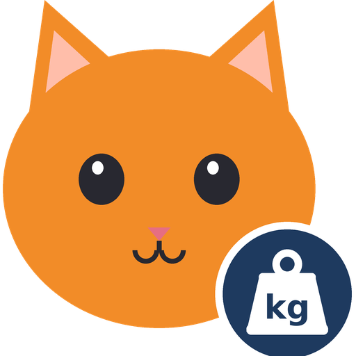
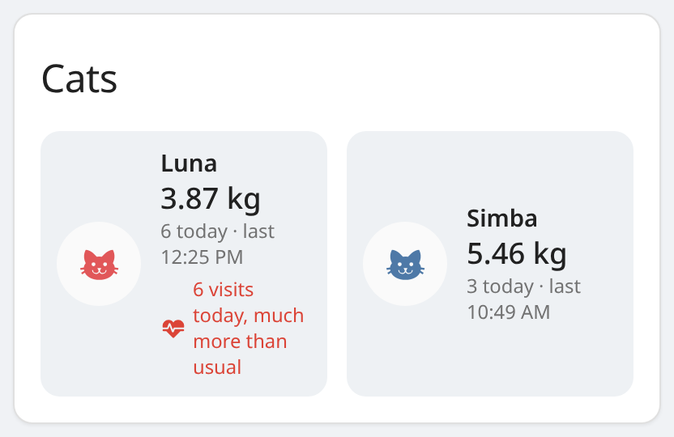
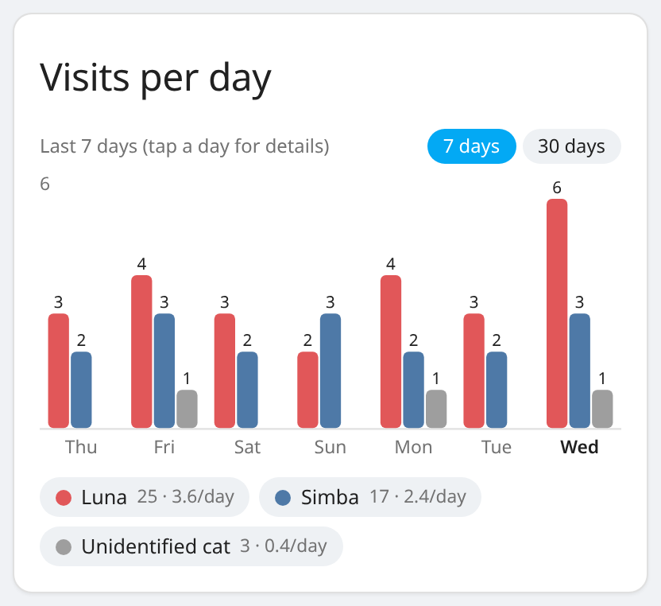
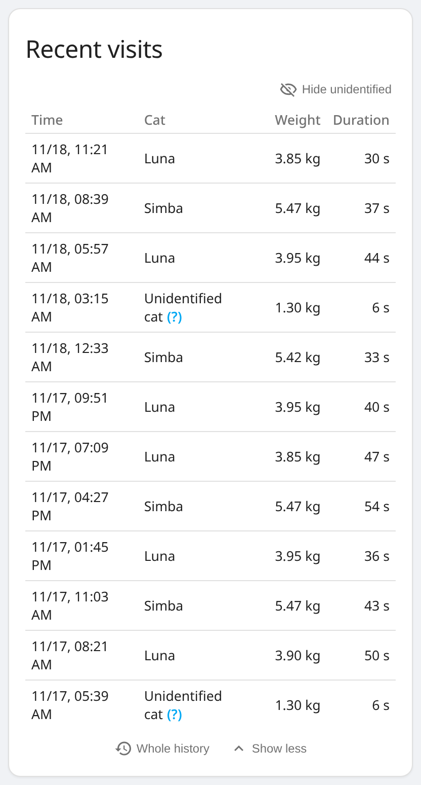
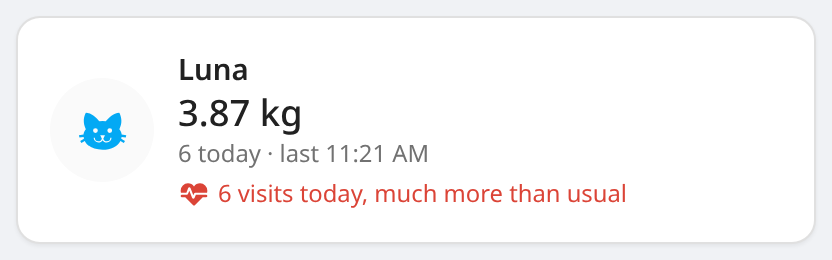
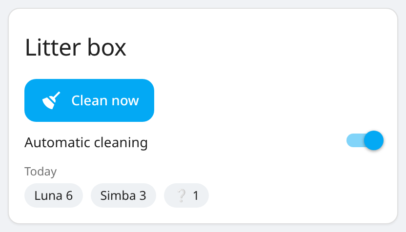
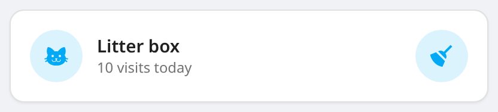

<p align="center">
  
</p>

# Litter Cat Identifier

[](https://hacs.xyz/docs/faq/custom_repositories)
[](https://github.com/cruzpazv/litter-cat-identifier/releases)
[](https://github.com/cruzpazv/litter-cat-identifier/actions/workflows/hassfest.yml)
[](https://github.com/cruzpazv/litter-cat-identifier/actions/workflows/hacs.yml)
[](LICENSE)
[](custom_components/litter_cat_identifier/manifest.json)
[](https://www.home-assistant.io/)

Home Assistant integration that tells your cats apart by weight on any automatic litter box that reports the cat's weight (Tuya, including UAHPET, Petkit, Litter-Robot, CATLINK…).

- Names each visit after the right cat, or logs it as **unidentified**
- **Learns** each cat's weight over time (cats gain and lose weight; the reference follows them)
- Per cat: learned weight (long-term statistics → trend graphs), visits today, last visit
- Visit log (up to 2000 visits; the sensor shows the latest 20, cards and the websocket API the rest)
- An **event entity** per litter box → automations like "notify if Luna hasn't visited in 24 h" or "Simba visited 6 times today"
- **Photo and colour per cat**: the photo shows on the cat's entities; the colour (cat settings) is used by the charts and by the icon when there is no photo
- **Notifications** from the UI: every visit, unidentified visits, or "no visit in X hours" per cat (photo attached on the HA mobile app)
- Unidentified readings come with a **likely reason**: a cat half inside right after its visit (and which cat), or a litter refill
- **Recalibrate** a cat's weight from its latest readings with one button
- Hide unidentified readings in the visits card, clear them with one button, or don't record them at all
- **Ready-made dashboard cards** with visual editors: one cat or several, recent visits, weight history and litter box controls (clean now)
- Service to fix a misidentified visit
- **Health alerts per cat**: many more visits than usual, a much longer visit than usual, or 5 % weight lost in three weeks (binary sensor per cat + optional notification)
- **Repairs** warning when the weight sensor looks like a live scale (it gives partial weights and the wrong cat)
- **UAHPET litter boxes** are recognised: the setup form fills itself in, and unidentified readings are explained with the litter box's state
- No cloud, no dependencies, config flow UI, English + Spanish

## Card previews

<table>
<tr><td><br><b>Cats</b>: weight, visits today, last visit and health alerts</td>
<td><br><b>Visits per day</b>: one bar per cat</td></tr>
<tr><td><br><b>Recent visits</b> as a collapsible list (expanded)</td>
<td><br><b>Cat</b>: a single cat<br><br><br><b>Litter box</b>: clean now, auto clean, today<br><br><br><b>Litter box (compact)</b>: clean only</td></tr>
</table>

Rendered from the real cards with sample data. The *Weight* card is Home Assistant's own statistics graph.

## How it works

1. Your litter box integration reports a weight (and ideally a visit counter).
2. On every visit, the reading is matched to the cat with the closest learned weight.
3. If it's within the tolerance (default 0.5 kg), the visit is assigned and that cat's learned weight moves a bit (default 20 %) towards the median of its latest 5 readings, so one odd reading does not drag it.
4. Otherwise it's logged as unidentified.
5. A reading well under the matched cat's weight within 2 minutes after a heavier cat's visit is logged as unidentified, *probably that cat half inside* (e.g. stepping back in to cover its waste).

**Visit detection**

| Mode | When | Notes |
|---|---|---|
| Counter (recommended) | Visit counter sensor increases | Catches every visit. Uses the current weight, or the last one seen in the past 10 min. |
| Weight only | Weight sensor changes and stays stable for 60 s | Two consecutive visits with exactly the same weight count as one (HA only reports changes). |

Works best when the cats differ by at least ~1 kg. With closer weights, lower the tolerance further and expect some unidentified visits.

## Install

[](https://my.home-assistant.io/redirect/hacs_repository/?owner=cruzpazv&repository=litter-cat-identifier&category=integration)

**HACS**
HACS → search for **Litter Cat Identifier** → Download → restart Home Assistant.

*Not listed yet?* The button above adds it for you, or add it as a custom repository: HACS → ⋮ → Custom repositories → `https://github.com/cruzpazv/litter-cat-identifier` → type *Integration*.

**Manual**
Copy `custom_components/litter_cat_identifier` into your `config/custom_components/` and restart.

## Setup

Settings → Devices & services → Add integration → **Litter Cat Identifier**

1. Name + sensors from your litter box: cat weight (required), visit counter (recommended), visit duration (optional).
2. Add each cat: name, approximate weight and (optionally) a photo picked or uploaded from Media.

**Changing the sensors later** (e.g. after moving the litter box to another integration): ⋮ on the integration → **Reconfigure**. Cats, learned weights, photos and visit history are kept.

**UAHPET litter box** with the [UAHPET integration](https://github.com/cruzpazv/uahpet-homeassistant): visit = the *Visit* event (it carries the weight and duration of each visit), weight = *Last cat weight*, duration = *Last visit duration*.

The weight sensor must hold the weight **of the visit**. A live scale (e.g. the Tuya integration's *cat weight*, UAHPET's *Live weight*) drops while the cat leaves, so visits get a partial weight and the wrong cat.

**Visit source**: a visit **event** entity (attributes `weight` and `duration`) is the most reliable. With a visit **counter**, the weight is taken from the weight sensor; if the counter ticks before the weight arrives, the visit waits up to 60 s for it.

**Options** (⚙ on the integration):

- *General settings & notifications*: tolerance, learning rate, minimum weight, record unidentified readings (on/off), notify services (e.g. `notify.mobile_app_my_phone`), notify unidentified visits, health alerts (on by default).
- *Cat: photo & notifications*: photo, notify every visit, alert after N hours without a visit (0 = off; one alert until the cat visits again).

**Photos**: in *Cat: photo & notifications*, tap **Photo** to pick an image from Media or upload one straight from your phone or computer. It's cropped square, resized to 512 px and stored by the integration — no File editor, no paths. Stored photos are only served to logged-in users (entities hand out short-lived signed links, like cameras do). Advanced: you can still type a `/local/...` path or an `https://` URL instead (note that `/local/` files are public to anyone who can reach Home Assistant).

## Entities

For a litter box named *Litter box* with cats *Luna* and *Simba*:

| Entity | Description |
|---|---|
| `sensor.litter_box_last_visit` | Last cat (or *unidentified*); attributes `time`, `weight`, `duration`, `reason`, `likely_cat`, `history` (last 20) |
| `sensor.litter_box_unidentified_visits_today` | Unidentified visits today |
| `sensor.litter_box_luna_weight` | Learned weight (kg) |
| `sensor.litter_box_luna_visits_today` | Visits today (resets at midnight) |
| `sensor.litter_box_luna_last_visit` | Timestamp of last visit |
| `binary_sensor.litter_box_luna_health` | On when a health signal is active; attribute `reasons` (`frequent_visits`, `long_visit`, `weight_loss`) with details. Needs about a week of history first |
| `event.litter_box_visit` | Fires per visit; `event_type` = cat name or `unidentified` |
| `switch.litter_box_show_unidentified_visits` | Show/hide unidentified readings in the *Recent visits* card (nothing is deleted) |
| `button.litter_box_clear_unidentified_visits` | Removes unidentified readings from the log and resets today's count |
| `button.litter_box_recalibrate_luna_weight` | Sets Luna's weight to the median of her last 5 weighed visits |

Entity IDs follow your HA language; check Settings → Entities.

## Unidentified readings

Every unidentified reading gets a best guess in `reason` (also in the visit log and notifications):

| `reason` | When | Meaning |
|---|---|---|
| `partial_after_visit` | ≤ 60 s after a cat's visit | That cat (`likely_cat`) half inside while leaving |
| `refill_or_partial` | otherwise | Litter refill, or a cat half in/out |
| `no_weight` | visit counted, no weight | The box didn't report a weight |

## Services

`litter_cat_identifier.reassign_last_visit` — fixes the latest visit:

```yaml
action: litter_cat_identifier.reassign_last_visit
data:
  cat: Simba
```

`litter_cat_identifier.recalibrate_weight` — resets a cat's learned weight to the median of its latest weighed visits (default 5), or to an exact value:

```yaml
action: litter_cat_identifier.recalibrate_weight
data:
  cat: Luna
  samples: 5      # or: weight: 4.2
```

`litter_cat_identifier.clear_unidentified_visits` — removes unidentified readings from the visit log and resets today's count.

`litter_cat_identifier.export_data` — returns one litter box's cats (learned weight, photo, colour, notifications), settings and visit history as a response (`config_entry_id` required). It's the stable format other integrations import from (UAHPET's *Import from Litter Cat Identifier* uses it).

## Custom automations

Built-in notifications cover the common cases. For anything else, use the event entity or the timestamps, e.g.:

```yaml
alias: Luna hasn't used the litter box in 24 h
triggers:
  - trigger: template
    value_template: >
      {{ now() - states('sensor.litter_box_luna_last_visit') | as_datetime > timedelta(hours=24) }}
actions:
  - action: notify.notify
    data:
      message: "Luna hasn't used the litter box in 24 hours."
```

## Dashboard cards

The integration ships its own cards. Edit a dashboard → **Add card** → search **Litter Cat Identifier**. Every card has a **visual editor**; resize them in the editor's *Layout* tab.

| Card | Shows | Editor options |
|---|---|---|
| **Cat** (`custom:litter-cat-identifier-cat`) | One cat: photo, name, weight, visits today and last visit | cat, horizontal/vertical layout, photo size, icon colour, which details to show |
| **Cats** (`custom:litter-cat-identifier-cats`) | Several cats together | which cats, cats per row, layout, photo size, which details to show |
| **Recent visits** (`custom:litter-cat-identifier-visits`) | Latest visits; unidentified ones show a **(?)** with the likely reason (hover, or tap on touch screens), and a 👁 button hides/shows them. As a **collapsible list** it shows a few visits, *Show more* expands it and *Whole history* loads every stored visit (up to 2000) | visits shown, collapsible, visits when expanded, weight/duration columns, hide button |
| **Weight** (`custom:litter-cat-identifier-weight`) | Weight history per cat; the chart fills the card size | days, period (hour/day/week/month), line or bars, average/min/max |
| **Visits per day** (`custom:litter-cat-identifier-visits-chart`) | Bars per day with **one bar per cat** (and grey for unidentified). Tap a cat in the legend to hide it, tap a day for its numbers, switch between 7 and 30 days | days, show unidentified, `colors` (YAML: `colors: {Luna: "#e15759"}`) |
| **Litter box** (`custom:litter-cat-identifier-box`) | **Clean now** button, automatic-cleaning switch, today's visits per cat | cleaning entity (switch, button or script from your litter box integration), auto-clean switch, confirmation |
| **Litter box, compact** (`custom:litter-cat-identifier-box-mini`) | One row: visits today and a clean button (tap twice to confirm) | cleaning entity, confirmation |

They find your litter box and cats automatically and follow your Home Assistant language (English/Spanish). All cards also accept `title`, `show_title: false` (hide the header), `scale` (0.7–1.5, *Size* in the editor: smaller or bigger) and `device_id` (only needed with more than one litter box). In a sections dashboard they fill the height you give them.

YAML example:

```yaml
type: custom:litter-cat-identifier-box
clean_entity: switch.my_litter_box_start
auto_clean_entity: switch.my_litter_box_auto_clean
confirm: true
```

```yaml
type: custom:litter-cat-identifier-visits
count: 5
collapsible: true
expanded_count: 30
```

The whole visit history is also available to your own cards and scripts through the websocket command `litter_cat_identifier/history` (`device_id`, `offset`, `limit`; newest first).

Prefer building your own? See [`examples/dashboard.yaml`](examples/dashboard.yaml).

## Limitations

- Cat names and the weight sensor are fixed after setup; to change them, remove and re-add the integration (learned weights are reset).
- Identification is weight-only. Cats within a few hundred grams of each other can't be told apart reliably.

## About

Built with the help of AI (Claude by Anthropic). Code is reviewed and covered by automated tests (Hassfest, HACS validation and unit/integration tests); please open an issue if something doesn't work as expected.

## License

MIT
